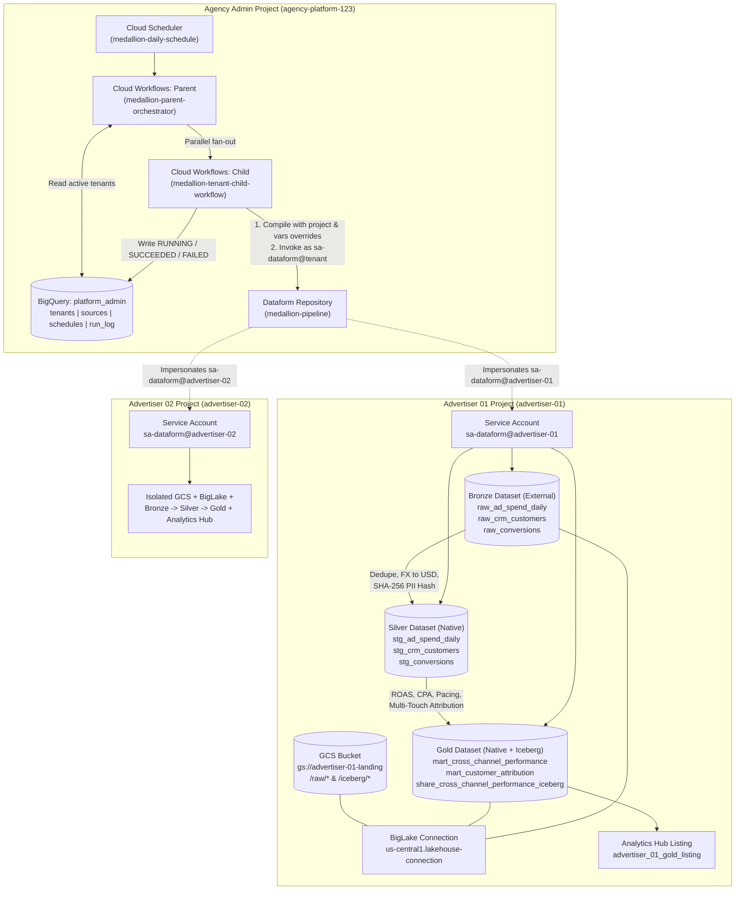

# Multi-Tenant, Isolated Agency-Advertisers Data Platform — Design Specification

**Date:** 2026-11-08  
**Target Customer Context:** Media Agency (GALE Alchemy Data Platform POC)  
**Target GCP Projects:**
- **Agency Admin Project (Control Plane):** `agency-platform-123`
- **Advertiser Tenant 01 Project:** `advertiser-01` ("Apex Apparel" — Retail / E-Commerce)
- **Advertiser Tenant 02 Project:** `advertiser-02` ("Nova FinTech" — Financial Services)
- **Default Region / BigQuery Location:** `us-central1`

---

## 1. Executive Summary & Architectural Goals

This design brings to life the **Multi-tenant, isolated, Advertiser Data Platform** reference architecture across three Google Cloud projects (`agency-platform-123`, `advertiser-01`, `advertiser-02`). It directly addresses the two primary requirements discussed with the GALE engineering leadership (Anooj and Vishnu):

1. **Centralized Management & Single Pane of Glass with Strict Tenant Data Isolation:**
   - The data engineering team operates from a single **Agency Admin project (`agency-platform-123`)** containing centralized orchestration (**Cloud Scheduler** + **Cloud Workflows** parent/child fan-out), a single shared **Dataform** SQLX Medallion repository, and a centralized operational metadata and run-logging dataset (`platform_admin`).
   - All data at rest (**Cloud Storage** landing/Iceberg buckets and **BigQuery** `bronze`, `silver`, `gold` datasets) and compute execution identities (`sa-dataform@<tenant_project>.iam.gserviceaccount.com`) remain strictly isolated inside each advertiser's dedicated GCP project (`advertiser-01`, `advertiser-02`).
2. **Zero-Copy Serving & Cross-Cloud Lakehouse Readiness (Apache Iceberg + Analytics Hub):**
   - Each tenant's curated Gold data is exposed both via **BigQuery Analytics Hub** (zero-copy linked datasets for GCP subscribers) and as a **BigLake Managed Apache Iceberg table** stored in Parquet/Iceberg format on the tenant's GCS bucket (`gold.share_cross_channel_performance_iceberg`), demonstrating readiness for cross-cloud catalog federation (such as AWS Glue / Amazon Redshift).

---

## 2. Scope Boundary: Live-Deployed vs. Feature-Flagged Reference Terraform

To keep the demo environment functional and free of networking lockouts or external API dependencies while still providing a complete reference implementation in Terraform:

### Live-Deployed in GCP (via Terraform + Python Seeder)
- **Agency Admin (`agency-platform-123`):**
  - BigQuery `platform_admin` dataset and 4 control plane tables (`tenants`, `sources`, `schedules`, `run_log`).
  - Central Dataform repository (`medallion-pipeline`) and workspace seeded with the Medallion SQLX codebase.
  - Orchestration service account (`sa-orchestrator@agency-platform-123.iam.gserviceaccount.com`).
  - Cloud Workflows: Parent fan-out workflow (`medallion-parent-orchestrator`) and per-tenant child workflow (`medallion-tenant-child-workflow`).
  - Cloud Scheduler job (`medallion-daily-schedule`) configured to trigger the parent workflow.
- **Advertiser Tenant Projects (`advertiser-01`, `advertiser-02`):**
  - Tenant execution service account (`sa-dataform@<tenant_project>.iam.gserviceaccount.com`) with least-privilege IAM scoped exclusively to its own project, plus cross-project token creator binding allowing `agency-platform-123`'s Dataform service agent to impersonate it.
  - GCS bucket (`gs://<tenant_project>-landing`) with `/raw/` prefix for incoming 1P/ad feeds and `/iceberg/` prefix for open Iceberg Gold tables.
  - BigLake Cloud Resource Connection (`us-central1.lakehouse-connection`) authorized on the tenant's GCS bucket.
  - BigQuery datasets: `bronze`, `silver`, `gold`.
  - 9 Medallion tables per tenant:
    - **Bronze (3 BigLake External tables over GCS CSV files):** `raw_ad_spend_daily`, `raw_crm_customers`, `raw_conversions`.
    - **Silver (3 Native BigQuery tables + Dataform assertions):** `stg_ad_spend_daily`, `stg_crm_customers`, `stg_conversions`.
    - **Gold (2 Native BigQuery marts + 1 BigLake Apache Iceberg sharing table):** `mart_cross_channel_performance`, `mart_customer_attribution`, `share_cross_channel_performance_iceberg`.
  - BigQuery Analytics Hub Data Exchange and per-advertiser Listing sharing the tenant's `gold` dataset zero-copy.

### Feature-Flagged in Terraform Reference Modules (`default = false`)
Included in `terraform/modules/enterprise_reference/` so the customer can inspect production-ready HCL without interfering with demo access:
- `vpc_sc.tf` (`enable_vpc_sc = false`): Per-tenant VPC Service Controls service perimeter and perimeter bridge to `agency-platform-123`.
- `cmek.tf` (`enable_cmek = false`): Per-tenant Cloud KMS key rings, crypto keys, and CMEK bindings on GCS and BigQuery datasets.
- `dts_connectors.tf` (`enable_dts_connectors = false`): BigQuery Data Transfer Service configs (Google Ads, CM360, DV360, SA360, GA4) and Cloud Run Jobs for 3P Ad APIs (Meta, TikTok, Amazon Ads, The Trade Desk) pulling API secrets from Secret Manager.
- `governance.tf` (`enable_dataplex_governance = false`): Dataplex / Knowledge Catalog lake, zones, data quality tasks, and business glossary entries.
- `monitoring.tf` (`enable_monitoring_alerts = false`): Cloud Monitoring SLA alert policies on workflow failures and FinOps per-tenant chargeback billing views.
- `cicd_cloudbuild.tf` (`enable_cloudbuild_cicd = false`): Cloud Build GitOps trigger for automated PR-based tenant onboarding ("Onboard Advertiser N+1").

---

## 3. System Architecture & IAM Isolation Model



### IAM & Least-Privilege Security Matrix

| Principal | Target Project / Resource | Roles Granted | Purpose |
| :--- | :--- | :--- | :--- |
| `sa-orchestrator@agency-platform-123` | `agency-platform-123` | `roles/bigquery.dataEditor`, `roles/bigquery.jobUser`, `roles/dataform.editor`, `roles/workflows.invoker`, `roles/logging.logWriter` | Reads `platform_admin.tenants`, writes `platform_admin.run_log`, compiles Dataform, invokes child workflows and Dataform runs. |
| `sa-orchestrator@agency-platform-123` | `sa-dataform@<tenant_project>` | `roles/iam.serviceAccountUser` | Allows the orchestrator workflow to pass `sa-dataform@<tenant_project>` in the Dataform `workflowInvocations.create` request. |
| `service-<ADMIN_PROJECT_NUMBER>@gcp-sa-dataform.iam.gserviceaccount.com` | `sa-dataform@<tenant_project>` | `roles/iam.serviceAccountTokenCreator`, `roles/iam.serviceAccountUser` | Allows the central Dataform service agent in `agency-platform-123` to execute SQL jobs as the tenant's service account. |
| `sa-dataform@<tenant_project>` | `<tenant_project>` **ONLY** | `roles/bigquery.dataEditor`, `roles/bigquery.jobUser`, `roles/bigquery.connectionUser`, `roles/storage.objectAdmin` | Executes all Bronze -> Silver -> Gold queries inside the tenant's own project. Zero permissions on any other tenant project. |
| BigLake Connection SA (`bqcx-...`) | `gs://<tenant_project>-landing` **ONLY** | `roles/storage.objectAdmin` | Reads `/raw/*.csv` for Bronze external tables and reads/writes `/iceberg/*` Parquet & metadata files for the Gold Iceberg table. |

---

## 4. Data Model & Medallion Transformation Specifications

### 4.1 Control Plane Dataset (`agency-platform-123.platform_admin`)

1. **`platform_admin.tenants`**
   - `tenant_id` (`STRING`, PK — e.g., `advertiser_01`, `advertiser_02`)
   - `project_id` (`STRING` — e.g., `advertiser-01`, `advertiser-02`)
   - `tenant_name` (`STRING` — e.g., `Apex Apparel`, `Nova FinTech`)
   - `industry` (`STRING` — e.g., `Retail & E-Commerce`, `Financial Services`)
   - `sla_tier` (`STRING` — e.g., `TIER_1_DAILY_0600`)
   - `service_account_email` (`STRING` — `sa-dataform@<project_id>.iam.gserviceaccount.com`)
   - `landing_bucket` (`STRING` — `<project_id>-landing`)
   - `biglake_connection_id` (`STRING` — `<project_id>.us-central1.lakehouse-connection`)
   - `default_currency` (`STRING` — `USD`)
   - `default_timezone` (`STRING` — `America/New_York`)
   - `is_active` (`BOOL`)
   - `onboarded_at` (`TIMESTAMP`)

2. **`platform_admin.sources`**
   - `tenant_id` (`STRING`), `source_name` (`STRING`), `source_type` (`STRING`), `gcs_uri` (`STRING`), `target_bronze_table` (`STRING`), `is_enabled` (`BOOL`)

3. **`platform_admin.schedules`**
   - `schedule_id` (`STRING`), `sla_tier` (`STRING`), `cron_schedule` (`STRING`), `description` (`STRING`)

4. **`platform_admin.run_log`**
   - `run_id` (`STRING`), `parent_execution_id` (`STRING`), `tenant_id` (`STRING`), `project_id` (`STRING`), `status` (`STRING`: `RUNNING`, `SUCCEEDED`, `FAILED`), `dataform_compilation_id` (`STRING`), `dataform_invocation_id` (`STRING`), `started_at` (`TIMESTAMP`), `completed_at` (`TIMESTAMP`), `notes` (`STRING`)

---

### 4.2 Per-Tenant Medallion Schema (9 Tables per Tenant in `advertiser-01` & `advertiser-02`)

#### Layer 1: Bronze (`<tenant_project>.bronze`) — BigLake External Tables
Backed by synthetic CSV files in `gs://<tenant_project>-landing/raw/` via `WITH CONNECTION \`<tenant_project>.us-central1.lakehouse-connection\``:

1. **`bronze.raw_ad_spend_daily`**
   - Columns: `feed_id STRING`, `report_date STRING`, `campaign_id STRING`, `campaign_name STRING`, `channel STRING`, `impressions INT64`, `clicks INT64`, `spend_raw FLOAT64`, `currency STRING`, `daily_budget_usd FLOAT64`, `ingested_at STRING`
   - Synthetic nuances: Includes duplicate rows (same `report_date`, `campaign_id`, `channel` with later `ingested_at`), mixed casing in `channel` (`google_ads`, `Google Ads`, `META`, `TikTok`, `DV360`), and multi-currency values (`USD`, `EUR`, `GBP`, `CAD`).
2. **`bronze.raw_crm_customers`**
   - Columns: `customer_id STRING`, `email STRING`, `phone STRING`, `first_name STRING`, `last_name STRING`, `loyalty_tier STRING`, `country STRING`, `signup_ts STRING`, `updated_at STRING`
   - Synthetic nuances: Contains cleartext PII (`email`, `phone`, `first_name`, `last_name`) and duplicate customer update snapshots.
3. **`bronze.raw_conversions`**
   - Columns: `conversion_id STRING`, `customer_id STRING`, `email STRING`, `campaign_id STRING`, `channel STRING`, `conversion_type STRING`, `revenue_raw FLOAT64`, `currency STRING`, `event_ts STRING`, `ingested_at STRING`
   - Synthetic nuances: Includes both online and offline conversions, duplicate conversion retries, and mixed currencies.

#### Layer 2: Silver (`<tenant_project>.silver`) — Cleansed & Conformed Native Tables (via Dataform)
4. **`silver.stg_ad_spend_daily`**
   - Deduplicates on `(report_date, campaign_id, channel)` ordering by `ingested_at DESC`.
   - Standardizes `channel` to upper snake case (`GOOGLE_ADS`, `META`, `TIKTOK`, `DV360`).
   - Normalizes `spend_raw` to `spend_usd` using deterministic FX rates (`USD: 1.0, EUR: 1.08, GBP: 1.27, CAD: 0.74`).
   - Partitioned by `report_date`, clustered by `channel`.
   - **Dataform Assertions**: `uniqueKey: ["report_date", "campaign_id", "channel"]`, `nonNull: ["report_date", "campaign_id", "channel", "spend_usd"]`, `rowConditions: ["spend_usd >= 0", "impressions >= clicks"]`.
5. **`silver.stg_crm_customers`**
   - Deduplicates on `customer_id` ordering by `updated_at DESC`.
   - Hashes PII fields using `TO_HEX(SHA256(LOWER(TRIM(email)))) AS email_hash` and `TO_HEX(SHA256(REGEXP_REPLACE(phone, r'[^0-9]', ''))) AS phone_hash`.
   - **Drops raw `email`, `phone`, `first_name`, `last_name` columns** so no cleartext PII enters Silver or Gold.
   - **Dataform Assertions**: `uniqueKey: ["customer_id"]`, `nonNull: ["customer_id", "email_hash"]`.
6. **`silver.stg_conversions`**
   - Deduplicates on `conversion_id` ordering by `ingested_at DESC`.
   - Parses `event_ts` to UTC `TIMESTAMP` and extracts `conversion_date`.
   - Hashes `email` to `email_hash` (dropping raw `email`) and converts `revenue_raw` to `revenue_usd`.
   - Partitioned by `conversion_date`.
   - **Dataform Assertions**: `uniqueKey: ["conversion_id"]`, `nonNull: ["conversion_id", "campaign_id", "revenue_usd"]`, `rowConditions: ["revenue_usd >= 0"]`.

#### Layer 3: Gold (`<tenant_project>.gold`) — Business Marts & Open Lakehouse Iceberg Table
7. **`gold.mart_cross_channel_performance` (Native BigQuery Table)**
   - Joins daily aggregated `silver.stg_ad_spend_daily` with attributed conversions from `silver.stg_conversions` by `(report_date, campaign_id, channel)`.
   - Computes business KPIs:
     - `impressions`, `clicks`, `spend_usd`, `daily_budget_usd`
     - `conversions_count`, `attributed_revenue_usd`
     - `ctr` (`SAFE_DIVIDE(clicks, impressions)`)
     - `cpa_usd` (`SAFE_DIVIDE(spend_usd, conversions_count)`)
     - `roas` (`SAFE_DIVIDE(attributed_revenue_usd, spend_usd)`)
     - `budget_pacing_pct` (`SAFE_DIVIDE(spend_usd, daily_budget_usd) * 100`)
   - **Dataform Assertions**: `uniqueKey: ["report_date", "campaign_id", "channel"]`, `nonNull: ["tenant_id", "report_date", "channel", "spend_usd"]`.
8. **`gold.mart_customer_attribution` (Native BigQuery Table)**
   - Joins `silver.stg_conversions` with `silver.stg_crm_customers` (via `customer_id` / `email_hash`) and campaign metadata from `silver.stg_ad_spend_daily`.
   - Produces privacy-safe attribution metrics per `customer_id`, `email_hash`, `loyalty_tier`, `country`, `primary_channel`, `total_conversions`, `lifetime_attributed_revenue_usd`, `first_touch_ts`, `last_touch_ts`.
9. **`gold.share_cross_channel_performance_iceberg` (BigLake Managed Apache Iceberg Table)**
   - Created and refreshed by a Dataform `operations` SQLX node (`definitions/gold/share_cross_channel_performance_iceberg.sqlx`) using:
     ```sql
     CREATE TABLE IF NOT EXISTS `${self()}`
     (
       tenant_id STRING,
       report_date DATE,
       campaign_id STRING,
       campaign_name STRING,
       channel STRING,
       impressions INT64,
       clicks INT64,
       spend_usd FLOAT64,
       daily_budget_usd FLOAT64,
       conversions_count INT64,
       attributed_revenue_usd FLOAT64,
       ctr FLOAT64,
       cpa_usd FLOAT64,
       roas FLOAT64,
       budget_pacing_pct FLOAT64,
       refreshed_at TIMESTAMP
     )
     WITH CONNECTION `${dataform.projectConfig.defaultDatabase}.us-central1.lakehouse-connection`
     OPTIONS (
       file_format = 'PARQUET',
       table_format = 'ICEBERG',
       storage_uri = 'gs://${dataform.projectConfig.vars.landing_bucket}/iceberg/cross_channel_performance'
     );

     TRUNCATE TABLE `${self()}`;

     INSERT INTO `${self()}`
     SELECT
       tenant_id,
       report_date,
       campaign_id,
       campaign_name,
       channel,
       impressions,
       clicks,
       spend_usd,
       daily_budget_usd,
       conversions_count,
       attributed_revenue_usd,
       ctr,
       cpa_usd,
       roas,
       budget_pacing_pct,
        refreshed_at
     FROM ${ref("mart_cross_channel_performance")};
     ```

---

## 5. Orchestration Flow (Cloud Workflows Parent & Child Fan-Out)

1. **`medallion-parent-orchestrator` (`agency-platform-123`)**:
   - Executes a BigQuery query against `agency-platform-123.platform_admin.tenants` to fetch all active tenants (`is_active = TRUE`).
   - Iterates over the active tenants using a `parallel: for:` loop and invokes `medallion-tenant-child-workflow` for each tenant concurrently.
2. **`medallion-tenant-child-workflow` (`agency-platform-123`)**:
   - Accepts `{ parent_execution_id, tenant_id, project_id, service_account_email, landing_bucket, biglake_connection_id }`.
   - **Step 1 (`log_run_start`)**: Inserts a new row into `agency-platform-123.platform_admin.run_log` with `status = 'RUNNING'`.
   - **Step 2 (`compile_dataform`)**: Calls `POST https://dataform.googleapis.com/v1beta1/projects/agency-platform-123/locations/us-central1/repositories/medallion-pipeline/compilationResults` with:
     - `workspace`: `projects/agency-platform-123/locations/us-central1/repositories/medallion-pipeline/workspaces/default`
     - `codeCompilationConfig`:
       - `defaultDatabase`: `project_id` (`advertiser-01` or `advertiser-02`)
       - `defaultSchema`: `silver`
       - `assertionSchema`: `silver_assertions`
       - `vars`: `{ "tenant_id": tenant_id, "landing_bucket": landing_bucket }`
   - **Step 3 (`invoke_dataform`)**: Calls `POST https://dataform.googleapis.com/v1beta1/projects/agency-platform-123/locations/us-central1/repositories/medallion-pipeline/workflowInvocations` with:
     - `compilationResult`: compilation result name from Step 2
     - `invocationConfig`:
       - `serviceAccount`: `service_account_email` (`sa-dataform@advertiser-01...` or `sa-dataform@advertiser-02...`)
       - `transitiveDependenciesIncluded`: `true`
       - `transitiveDependentsIncluded`: `true`
   - **Step 4 (`poll_dataform_status`)**: Polls `GET https://dataform.googleapis.com/v1beta1/{invocation_name}` every 5 seconds until `state` is `SUCCEEDED`, `FAILED`, or `CANCELLED`.
   - **Step 5 (`log_run_completion`)**: Updates `agency-platform-123.platform_admin.run_log` with final `status`, `dataform_compilation_id`, `dataform_invocation_id`, `completed_at = CURRENT_TIMESTAMP()`, and notes.

---

## 6. Repository Directory Structure

```text
agency-advertisers-platform/
├── README.md
├── docs/
│   └── superpowers/
│       └── specs/
│           └── 2026-11-08-agency-advertisers-platform-design.md
├── terraform/
│   ├── versions.tf
│   ├── variables.tf
│   ├── terraform.tfvars
│   ├── main.tf
│   ├── outputs.tf
│   └── modules/
│       ├── agency_admin/
│       │   ├── main.tf
│       │   ├── variables.tf
│       │   └── outputs.tf
│       ├── tenant_factory/
│       │   ├── main.tf
│       │   ├── variables.tf
│       │   └── outputs.tf
│       └── enterprise_reference/
│           ├── variables.tf
│           ├── vpc_sc.tf
│           ├── cmek.tf
│           ├── dts_connectors.tf
│           ├── governance.tf
│           ├── monitoring.tf
│           └── cicd_cloudbuild.tf
├── dataform/
│   ├── workflow_settings.yaml
│   └── definitions/
│       ├── bronze/
│       │   ├── raw_ad_spend_daily.sqlx
│       │   ├── raw_crm_customers.sqlx
│       │   └── raw_conversions.sqlx
│       ├── silver/
│       │   ├── stg_ad_spend_daily.sqlx
│       │   ├── stg_crm_customers.sqlx
│       │   └── stg_conversions.sqlx
│       └── gold/
│           ├── mart_cross_channel_performance.sqlx
│           ├── mart_customer_attribution.sqlx
│           └── share_cross_channel_performance_iceberg.sqlx
├── workflows/
│   ├── parent_orchestrator.yaml
│   └── tenant_child_workflow.yaml
└── scripts/
    ├── generate_and_load_synthetic_data.py
    ├── seed_dataform_workspace.py
    └── verify_platform.py
```

---

## 7. Verification & Acceptance Criteria

1. **Terraform Provisioning**: `terraform apply` succeeds cleanly across `agency-platform-123`, `advertiser-01`, and `advertiser-02`; `terraform validate` passes with all enterprise reference modules included.
2. **Synthetic Data & Bronze External Tables**: Querying `bronze.raw_ad_spend_daily`, `bronze.raw_crm_customers`, and `bronze.raw_conversions` in both `advertiser-01` and `advertiser-02` returns raw rows directly from each tenant's GCS landing bucket.
3. **End-to-End Cloud Workflows Fan-Out**: Executing `medallion-parent-orchestrator` in `agency-platform-123` fans out in parallel to `advertiser-01` and `advertiser-02`, compiles Dataform with tenant overrides, executes Dataform as `sa-dataform@<tenant_project>`, and logs `SUCCEEDED` in `agency-platform-123.platform_admin.run_log`.
4. **Medallion Data Quality & Transformations**:
   - Silver tables contain deduplicated records, USD-normalized spend/revenue, and SHA-256 hashed PII with zero raw email/phone columns; all Dataform assertions pass.
   - Gold native tables (`mart_cross_channel_performance`, `mart_customer_attribution`) and the Gold Managed Iceberg table (`share_cross_channel_performance_iceberg`) are populated and queryable in both tenant projects, with Parquet data and Iceberg metadata files verified in `gs://<tenant_project>-landing/iceberg/`.
5. **Analytics Hub & Tenant Isolation**: Analytics Hub listings exist in each tenant project, and IAM verification confirms `sa-dataform@advertiser-01` is denied access to `advertiser-02`.
